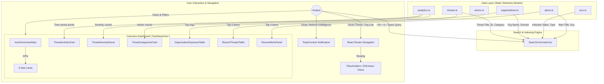
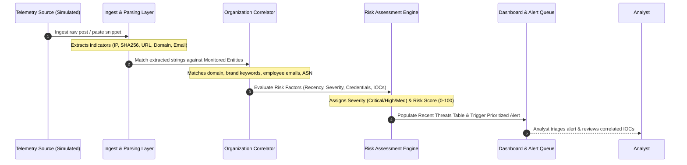

# DARKTRACE: Dark Web Threat Intelligence & Organization Exposure Monitoring Platform
## Comprehensive Technical System Documentation & Research Report

---

### Document Information
- **Project Title:** DARKTRACE – Dark Web Threat Intelligence & Organization Exposure Monitoring Platform
- **Classification:** Academic & Defensive Security Research / MSc Cybersecurity Project
- **Current Version:** 0.0.0 (Phase 1–5 Base Implementation: Executive Overview Dashboard, Telemetry Registry, Global Search & Design System)
- **Primary Frameworks:** React 19, TypeScript 6.0, Vite 8.3, Tailwind CSS v3.4, Recharts v3.10
- **Document Author:** Cybersecurity Architecture & Security Engineering Team
- **Target Audience:** Academic Supervisors, SOC Analysts, Threat Researchers, Security Software Engineers

---

## Table of Contents
1. [Project Overview](#1-project-overview)
2. [Problem Statement](#2-problem-statement)
3. [Objectives](#3-objectives)
4. [System Architecture](#4-system-architecture)
5. [Technology Stack](#5-technology-stack)
6. [Project Structure](#6-project-structure)
7. [DARKTRACE Functional Modules](#7-darktrace-functional-modules)
8. [IOC Analysis](#8-ioc-analysis)
9. [Organization Exposure Monitoring](#9-organization-exposure-monitoring)
10. [Threat Actor Intelligence](#10-threat-actor-intelligence)
11. [Exploit / CVE Intelligence](#11-exploit--cve-intelligence)
12. [Risk Assessment](#12-risk-assessment)
13. [Dashboard Architecture & Visualization](#13-dashboard-architecture--visualization)
14. [User Workflow](#14-user-workflow)
15. [Data Model](#15-data-model)
16. [API Documentation](#16-api-documentation)
17. [Data Processing Workflow](#17-data-processing-workflow)
18. [NLP / Machine Learning Assessment](#18-nlp--machine-learning-assessment)
19. [Security Considerations](#19-security-considerations)
20. [Ethical and Legal Considerations](#20-ethical-and-legal-considerations)
21. [Setup and Installation](#21-setup-and-installation)
22. [How to Run the Project](#22-how-to-run-the-project)
23. [Testing Strategy](#23-testing-strategy)
24. [Screenshots & Documentation Figures](#24-screenshots--documentation-figures)
25. [Current Limitations](#25-current-limitations)
26. [Future Scope & Roadmap](#26-future-scope--roadmap)
27. [Troubleshooting Guide](#27-troubleshooting-guide)
28. [Developer & Extension Guide](#28-developer--extension-guide)
29. [Internship & Master's Report Mapping](#29-internship--masters-report-mapping)
30. [Implementation Verification Summary (Mandatory Audit)](#30-implementation-verification-summary-mandatory-audit)

---

## 1. Project Overview

### 1.1 Project Name & Core Purpose
**DARKTRACE** is a dark-web threat intelligence aggregation, correlation, and organization exposure monitoring platform engineered as a modular, client-side Security Operations Center (SOC) dashboard. The application provides defensive security teams and SOC analysts with unified visibility into external threat telemetry, including credential dumps, compromised infrastructure discussions, vulnerability chatter, and threat actor profiling.

### 1.2 The Dark Web Threat Landscape & Organization Exposure
Modern cyber adversaries, ransomware syndicates, and initial access brokers (IABs) operate within decentralized underground forums, paste sites, and illicit marketplaces. Critical enterprise risks originate externally long before perimeter alarms trigger:
- Corporate credentials leaked from third-party vendor breaches.
- Threat actor discussions planning attacks against specific industry verticals.
- Exploitation of enterprise VPN and remote gateways advertised on underground communication channels.
- Brand impersonation kits and typosquatted domains staged for spearphishing campaigns.

Traditional perimeter telemetry (firewalls, internal IDS/IPS) lacks visibility into these pre-attack staging grounds. **Organization Exposure Monitoring** proactively identifies where company assets (brand names, root domains, employee email addresses, IP blocks, and executive identities) intersect with external threat chatter.

### 1.3 What DARKTRACE Currently Does
The current implementation of DARKTRACE provides a high-fidelity, interactive threat intelligence dashboard and investigative workbench:
- **Centralized Threat Telemetry Display:** Visualizes 1,284 active threats categorized across 8 vectors (Credential Exposure, Data Leaks, Ransomware, Exploits, Malware, Phishing, Fraud, and Organization Mentions).
- **Time-Series Analysis:** Visualizes threat frequency and critical severity trends across selectable time windows (24H, 7D, 30D, 90D).
- **Organization Exposure Scoring:** Quantifies exposure across enterprise entities (such as *ExampleBank*, *TechNova*, *FinSecure*, *CloudMatrix*), tracking mentions, risk levels, credential compromise, and exposure direction (up/down/stable).
- **Synthetic IOC Registry:** Structures Indicators of Compromise (Domains, IPs, URLs, Emails, SHA-256, SHA-1, MD5) tied to concrete threat incidents.
- **Alert Queue & Triage:** Aggregates prioritized security alerts with severity classifications and real-time status tracking.
- **Global Command Palette (Ctrl+K):** Enables keyboard-driven instant search across all threats, monitored organizations, IOCs, and alerts.

### 1.4 Scope Demarcation: Current Implementation vs. Future Scope

| Dimension | Current Implementation (Verified Codebase) | Future Scope (Planned Architecture) |
|---|---|---|
| **Platform Type** | Client-Side Single Page Application (SPA) in React 19 + TypeScript + Vite | Distributed Full-Stack Platform with Backend Services |
| **Data Engine** | Strongly typed synthetic telemetry datasets (`src/data/*.ts`) | Database (PostgreSQL / MongoDB / OpenSearch) with live ingestion pipelines |
| **Data Collection** | Static, simulated intelligence records modeling dark-web formats | Authorized live Tor/I2P crawlers, paste aggregators, and commercial CTI feeds |
| **Risk Scoring** | Attribute-based static risk models with categorical risk factors | Runtime algorithmic multi-variable scoring engine with custom weighting |
| **NLP/ML** | Rule-structured metadata and static entity correlation | Fine-tuned Named Entity Recognition (NER), transformer models, and embedding search |
| **Active Pages** | Master Dashboard (`/dashboard`), Global Search Modal, App Shell | Dedicated drill-down pages for Threat Intel, Orgs, Actors, IOCs, Graph, and Reports |
| **Authentication** | Visual mock user persona (SOC Analyst profile in navbar) | Role-Based Access Control (RBAC), OAuth2 / SAML SSO, and audit logging |

---

## 2. Problem Statement

Defensive cybersecurity teams face several operational bottlenecks when handling dark web threat intelligence:

1. **Information Overload and Fragmentation:** Threat intelligence analysts must parse disparate forums, paste repositories, leak sites, and vulnerability advisories. Manually cross-referencing raw strings against corporate assets is labor-intensive and prone to human error.
2. **Delayed Exposure Visibility:** Credentials, infrastructure vulnerabilities, or executive names often circulate on illicit boards days or weeks before exploitation. Without centralized aggregation, security teams cannot detect external exposure before an incident occurs.
3. **Correlation Complexity:** An isolated IP address, a compromised hash, or an anonymous paste snippet is of limited value without context. Analysts struggle to correlate an Indicator of Compromise (IOC) to the specific threat actor group, associated campaign, and targeted enterprise asset.
4. **Lack of Organization-Specific Relevance:** Generic threat feeds flood SOC analysts with thousands of irrelevant global indicators. Analysts need threat intelligence contextualized specifically to their organization's root domains, subdomains, brand terms, and technological dependencies.
5. **Absence of Unified Triage & Visualization:** Disjointed tools hinder fast incident triage. Security leadership requires executive metrics (exposure trends, severity distributions), while tier-1 analysts require granular IOC lists and evidence snippets.

DARKTRACE directly addresses these challenges by consolidating external threat feeds into an intuitive, organization-correlated intelligence dashboard.

---

## 3. Objectives

The development and architecture of DARKTRACE are governed by concrete technical and security objectives derived directly from the implemented codebase:

### Technical Objectives
1. **Develop an Enterprise React 19 Architecture:** Build a modular, strictly typed client application using modern frontend technologies (React 19, TypeScript 6.0, Vite 8.3, and Tailwind CSS v3.4).
2. **Implement Interactive Threat Visualizations:** Construct responsive charts and distribution widgets using Recharts to present time-series detections, category distributions, and severity breakdowns.
3. **Model Threat Intelligence Entities:** Establish rigorous TypeScript schemas representing core cyber threat entities: `Threat`, `Organization`, `ThreatActor`, `IOC`, `Exploit`, `Alert`, and `SourceFeed`.
4. **Provide Organization Exposure Tracking:** Track organizational exposure through domain matching, keyword association, credential exposure tracking, and risk level assignment.
5. **Structure Comprehensive Indicator Registries:** Support diverse indicator types (IPv4, Domains, URLs, Email Addresses, SHA-256, SHA-1, MD5) correlated with threat records.
6. **Implement Global Instant Search:** Deliver a keyboard-navigable command palette (`Ctrl+K`) supporting multi-entity real-time search across threats, organizations, IOCs, and alerts.
7. **Simulate Real-World SOC Workflows:** Provide an operational dashboard simulating alert prioritization, threat triage, status tracking (`New`, `Investigating`, `Resolved`, `False Positive`), and telemetry synchronization.

---

## 4. System Architecture

### 4.1 Architectural Overview
The current version of DARKTRACE is designed as a high-performance **Client-Side Single Page Application (SPA)**. It decouples interface presentation and analytical state management from the data layer, preparing the foundation for future microservice backend integration.

```
+-----------------------------------------------------------------------------------+
|                              PRESENTATION LAYER (UI)                              |
|  +--------------------+  +-----------------------+  +--------------------------+  |
|  |   AppLayout / Nav  |  |  Dashboard Container  |  |  Command Palette (Ctrl+K)|  |
|  +--------------------+  +-----------------------+  +--------------------------+  |
|            |                         |                           |                |
|            v                         v                           v                |
|  +-----------------------------------------------------------------------------+  |
|  |                           COMPONENT LIBRARY (ATOMIC)                        |  |
|  |  - StatCard            - SeverityBadge         - ConfidenceBar              |  |
|  |  - StatusBadge         - EmptyState            - ErrorState / LoadingState  |  |
|  +-----------------------------------------------------------------------------+  |
+-----------------------------------------------------------------------------------+
                                         |
                                         v
+-----------------------------------------------------------------------------------+
|                           VISUALIZATION & ANALYTICS LAYER                         |
|  +---------------------------+  +----------------------+  +---------------------+ |
|  | ThreatActivityChart (Area)|  | ThreatSeverity (Pie) |  | ThreatCategories    | |
|  +---------------------------+  +----------------------+  +---------------------+ |
|  +---------------------------+  +----------------------+                          |
|  | OrganizationExposureTable |  | RecentAlertsPanel    |                          |
|  +---------------------------+  +----------------------+                          |
+-----------------------------------------------------------------------------------+
                                         |
                                         v
+-----------------------------------------------------------------------------------+
|                         DATA & STATE MANAGEMENT LAYER                             |
|  +---------------------------+  +-----------------------------------------------+ |
|  | ToastContext (User Events)|  | React Router DOM v7 (Route State & History)   | |
|  +---------------------------+  +-----------------------------------------------+ |
|  +------------------------------------------------------------------------------+ |
|  | Static Telemetry Datasets (`src/data/*.ts`)                                  | |
|  | - threats.ts      - organizations.ts   - actors.ts      - iocs.ts            | |
|  | - alerts.ts       - analytics.ts       - sources.ts                          | |
|  +------------------------------------------------------------------------------+ |
+-----------------------------------------------------------------------------------+
                                         |
                                         v
+-----------------------------------------------------------------------------------+
|                            CORE DATA SCHEMAS & TYPES                              |
|  +------------------------------------------------------------------------------+ |
|  | TypeScript Strict Interfaces (`src/types/index.ts`)                          | |
|  | Threat | Organization | ThreatActor | IOC | Exploit | Alert | SourceFeed     | |
|  +------------------------------------------------------------------------------+ |
+-----------------------------------------------------------------------------------+
```

### 4.2 Architectural Layers Explained

1. **Presentation & Shell Layer (`src/components/layout`):**
   - `AppLayout.tsx`: Coordinates the global screen grid, housing the collapsible sidebar and top navigation header.
   - `Sidebar.tsx`: Handles primary navigation, stateful menu collapsing, active route highlighting, and module categorization.
   - `TopNavbar.tsx`: Provides dynamic breadcrumb generation, quick-access notifications popup with alert previews, and the global search invocation trigger.
2. **Dashboard & Visualization Layer (`src/components/dashboard`):**
   - Houses the core interactive analytical components that render metrics from the data store.
   - Uses Recharts SVG engines wrapped in responsive containers with customized tooltips and legends.
3. **Common Reusable UI Library (`src/components/common`):**
   - Encapsulates standardized enterprise components (`SeverityBadge`, `ConfidenceBar`, `StatusBadge`, `StatCard`, `SearchCommand`).
   - Ensures visual consistency and consistent token usage across the application.
4. **Data Modeling & Storage Layer (`src/data` & `src/types`):**
   - Acts as the localized intelligence repository.
   - Provides strongly typed synthetic intelligence objects reflecting real-world OSINT and dark-web telemetry records.
5. **Application Context Layer (`src/context`):**
   - `ToastContext.tsx`: Provides non-blocking alert messaging across the platform for simulated events (such as telemetry cache refresh).

### 4.3 High-Level Data Flow Diagram
The following Mermaid diagram traces how intelligence data moves through the application components:



### 4.4 Threat Intelligence Processing Workflow
The conceptual pipeline implemented in the data schemas and visualized on the dashboard follows a standard intelligence lifecycle:



---

## 5. Technology Stack

Every technology listed below was verified directly against `package.json`, configuration files, and source code. No unverified technologies are included.

| Category | Technology | Version | Purpose | Actual Codebase Usage |
|---|---|---|---|---|
| **Core Framework** | React.js | `^19.2.8` | UI Library | Core application architecture, functional components, hooks (`useState`, `useEffect`, `useContext`, `useRef`). |
| **DOM Engine** | React DOM | `^19.2.8` | DOM Rendering | Root client rendering in `src/main.tsx`. |
| **Language** | TypeScript | `~6.0.2` | Static Typing | Complete type safety, strict interface definitions in `src/types/index.ts`, typed components. |
| **Build Tool & Bundler** | Vite | `^8.3.0` | Development Server & Bundling | Rapid HMR dev server and optimized Rollup production compilation (`vite.config.ts`). |
| **Routing** | React Router DOM | `^7.18.4` | Client-side Routing | `BrowserRouter`, `Routes`, `Route`, `Navigate`, `useNavigate`, `useLocation`, `useParams` in `src/App.tsx`. |
| **CSS Framework** | Tailwind CSS | `^3.4.17` | Utility-first CSS | Styling system, enterprise color palette, custom shadows, and responsive layouts (`tailwind.config.js`). |
| **CSS Processing** | PostCSS | `^8.5.28` | CSS Transformations | PostCSS runner configured via `postcss.config.js`. |
| **CSS Vendor Prefixes** | Autoprefixer | `^10.6.1` | Cross-browser CSS | Applied automatically via PostCSS. |
| **Class Utilities** | clsx & tailwind-merge | `^2.1.1` / `^3.7.0` | Dynamic Class Names | Clean conditional class name merging in UI components. |
| **Data Visualization** | Recharts | `^3.10.1` | Charting Library | AreaChart (Threat Activity), BarChart (Categories), PieChart (Severity Donut). |
| **Iconography** | Lucide React | `^1.47.0` | Vector Icons | Security icons (`ShieldAlert`, `Crosshair`, `Building2`, `Bell`, `KeyRound`, etc.). |
| **Static Code Analysis** | Oxlint | `^1.81.0` | High-speed Linter | Fast Rust-based linter configured via `.oxlintrc.json`. |

> [!NOTE]
> **Absent Technologies (Verified Not Present in Repository):**
> Python, Pandas, NumPy, Scikit-learn, Tor daemon, Scrapy, BeautifulSoup, Express, FastAPI, Django, PostgreSQL, MongoDB, Redis, Docker, and Vitest are **not installed or utilized** in this repository. The project is an exclusively frontend client application using static TypeScript data fixtures.

---

## 6. Project Structure

The repository structure is organized as follows:

```
DARKTRACE/
├── .gitignore                   # Standard git exclusions (node_modules, dist, etc.)
├── .oxlintrc.json               # Oxlint static analysis configuration
├── index.html                   # HTML entry point (title, viewport, root element)
├── package.json                 # Project dependencies, scripts, metadata
├── package-lock.json            # Deterministic dependency tree lockfile
├── postcss.config.js            # PostCSS configuration with Tailwind and Autoprefixer
├── README.md                    # Project README documentation
├── tailwind.config.js           # Tailwind theme configuration, custom colors, fonts
├── tsconfig.app.json            # TypeScript configuration for application source
├── tsconfig.json                # Master TypeScript project configuration
├── tsconfig.node.json           # TypeScript configuration for build tool environments
├── vite.config.ts               # Vite configuration with React plugin
├── public/                      # Static assets distributed with build
│   ├── favicon.svg              # DarkTrace application tab icon
│   └── icons.svg                # SVG sprite definitions
└── src/                         # Application source code
    ├── App.css                  # Minimal top-level application CSS reset
    ├── App.tsx                  # Master application router and layout root
    ├── index.css                # Base Tailwind imports, custom scrollbars, card classes
    ├── main.tsx                 # React DOM mount point rendering <App />
    ├── assets/                  # Local static graphical assets
    │   ├── hero.png             # Hero banner illustration
    │   ├── react.svg            # React branding asset
    │   └── vite.svg             # Vite branding asset
    ├── components/              # Modular UI components
    │   ├── common/              # Generic reusable interface widgets
    │   │   ├── ConfidenceBar.tsx    # Visual 0-100% confidence level indicator
    │   │   ├── EmptyState.tsx       # Standardized fallback display for empty data
    │   │   ├── ErrorState.tsx       # Standardized error presentation container
    │   │   ├── LoadingState.tsx     # Animated spinner for loading views
    │   │   ├── SearchCommand.tsx    # Ctrl+K modal global command palette
    │   │   ├── SeverityBadge.tsx    # Severity pill badge with icons and colors
    │   │   ├── StatCard.tsx         # KPI card with trends and icon mapping
    │   │   └── StatusBadge.tsx      # Lifecycle state indicator (New, Investigating...)
    │   ├── dashboard/           # Specialized analytical widgets for Overview
    │   │   ├── OrganizationExposureTable.tsx # Top monitored orgs ranking
    │   │   ├── RecentAlertsPanel.tsx         # Prioritized alert triage queue
    │   │   ├── RecentThreatsTable.tsx        # Ingested threat telemetry stream
    │   │   ├── ThreatActivityChart.tsx       # Recharts AreaChart with time filters
    │   │   ├── ThreatCategoriesChart.tsx     # Recharts vertical bar breakdown
    │   │   └── ThreatSeverityDonut.tsx       # Recharts donut severity breakdown
    │   └── layout/              # Application framing and shell
    │       ├── AppLayout.tsx        # Grid wrapper with sidebar and topbar
    │       ├── Sidebar.tsx          # Collapsible navigation drawer
    │       └── TopNavbar.tsx        # Breadcrumb navigation, alerts menu, search trigger
    ├── context/                 # Application global state providers
    │   └── ToastContext.tsx     # Global toast notification context and provider
    ├── data/                    # Synthetic threat intelligence datasets
    │   ├── actors.ts            # Threat actor profiles, motivations, and aliases
    │   ├── alerts.ts            # Security alerts with severity and org links
    │   ├── analytics.ts         # Time-series datasets, severity counts, category counts
    │   ├── iocs.ts              # Synthetic IOC indicators (IP, Hash, URL, Domain)
    │   ├── organizations.ts     # Monitored organizational entities and metrics
    │   ├── sources.ts           # Intelligence feed source registry and health
    │   └── threats.ts           # Rich threat records with evidence and indicators
    ├── pages/                   # Top-level view containers
    │   ├── Dashboard.tsx        # Fully implemented Master Overview Dashboard
    │   └── Placeholders.tsx     # Phase 6-15 placeholder pages with navigation
    └── types/                   # TypeScript interfaces and type definitions
        └── index.ts             # Complete domain model definitions
```

---

## 7. DARKTRACE Functional Modules

### 7.1 Module Implementation Matrix

| Module | Route | Implementation Status | Data Source | Security Function |
|---|---|---|---|---|
| **Overview Dashboard** | `/dashboard` | **Fully Implemented** | `src/data/*.ts` | Executive KPIs, charts, recent threats, alerts queue, org rankings. |
| **Global Search** | Modal (`Ctrl+K`) | **Fully Implemented** | Multi-file filter | Cross-entity keyword search across threats, orgs, IOCs, and alerts. |
| **Threat Intelligence** | `/threat-intelligence` | Placeholder (Phase 6) | `src/data/threats.ts` | Threat feed investigation and correlation. |
| **Threat Detail** | `/threat-intelligence/:id` | Placeholder (Phase 6) | `src/data/threats.ts` | Detailed forensics, raw snippet, indicator list, timeline. |
| **Monitored Organizations**| `/organizations` | Placeholder (Phase 7) | `src/data/organizations.ts`| Enterprise perimeter and exposure score management. |
| **Organization Detail** | `/organizations/:id` | Placeholder (Phase 7) | `src/data/organizations.ts`| Org-specific credential leaks, targeting actors, and risk trends. |
| **Threat Actors** | `/threat-actors` | Placeholder (Phase 8) | `src/data/actors.ts` | Profiling adversary groups, aliases, origins, sophistication. |
| **Threat Actor Detail** | `/threat-actors/:id` | Placeholder (Phase 8) | `src/data/actors.ts` | Actor TTP timeline, targeted sectors, associated threats. |
| **IOC Intelligence** | `/iocs` | Placeholder (Phase 9) | `src/data/iocs.ts` | Searchable indicator repository (IPs, Hashes, Domains). |
| **Exploit Intelligence** | `/exploits` | Placeholder (Phase 10) | Type defined in `types` | CVE tracker, exploit chatter, patch status. |
| **Security Alerts** | `/alerts` | Placeholder (Phase 11) | `src/data/alerts.ts` | Dedicated queue for security alert triage. |
| **Threat Relationship Graph**| `/threat-graph` | Placeholder (Phase 12) | Relational references | Multi-node entity graph connecting actors, threats, orgs, IOCs. |
| **Analytics & Telemetry** | `/analytics` | Placeholder (Phase 13) | `src/data/analytics.ts`| Trend analytics, category velocity, and exposure shifts. |
| **Intelligence Reports** | `/reports` | Placeholder (Phase 14) | Static structures | Executive threat briefings, exposure audits, scheduled exports. |
| **Intelligence Sources** | `/sources` | Placeholder (Phase 15) | `src/data/sources.ts` | Telemetry feed registry, reliability scores, health checks. |
| **Live Monitoring** | `/monitoring` | Placeholder (Phase 15) | Synthetic telemetry | Stream simulation for ingestion sensors. |
| **Settings & Preferences**| `/settings` | Placeholder (Phase 15) | Client preferences | Analyst thresholds, notification preferences, monitoring scope. |
| **Help & Documentation** | `/help` | Placeholder (Phase 15) | Informational | Platform documentation, MITRE ATT&CK reference mapping. |

### 7.2 Detailed Analysis of Implemented Modules

#### Module 1: Overview Dashboard (`src/pages/Dashboard.tsx`)
- **Purpose:** Central operational canvas synthesizing high-level threat trends, prioritized alerts, organizational exposure, and recent intelligence records into a single pane of glass.
- **Inputs:** `mockOverviewStats`, `mockThreatActivity`, `mockThreatSeverityDistribution`, `mockThreatCategoriesDistribution`, `mockOrganizations`, `mockThreats`, `mockAlerts`.
- **Outputs:** Interactive stat cards with trends, two-series area chart with time filter buttons (24H/7D/30D/90D), vertical category breakdown chart, severity donut chart with counts/percentages, exposure summary table, threat table with click-to-route behavior, and an alerts triage panel.
- **Important Functions/Hooks:** `useState` for refresh spinner and last updated label; `useToast` to dispatch feedback banners on manual synchronization.

#### Module 2: Global Search & Command Palette (`src/components/common/SearchCommand.tsx`)
- **Purpose:** Rapid-access investigative shortcut allowing analysts to quickly locate any threat ID, domain, hash, IP address, or organizational entity without navigating deep menus.
- **Inputs:** Raw text query entered into search input; triggered globally via `Ctrl+K` or top navigation search bar.
- **Processing:** Real-time client-side substring matching across 4 distinct entity collections simultaneously:
  - `mockThreats` (matches `title`, `category`, `organization`, `id`)
  - `mockOrganizations` (matches `name`, `domain`, `industry`)
  - `mockIOCs` (matches `value`, `type`, `organization`)
  - `mockAlerts` (matches `title`, `organization`)
- **Outputs:** Grouped categorical result list displaying badges, entity names, sub-metadata, and click-to-navigate action.

---

## 8. IOC Analysis

### 8.1 Supported IOC Types
DARKTRACE natively defines and supports 7 distinct Indicator of Compromise (IOC) types in its type union (`IOCType` in `src/types/index.ts`):

```typescript
export type IOCType = 'DOMAIN' | 'IP' | 'URL' | 'EMAIL' | 'SHA256' | 'SHA1' | 'MD5';
```

### 8.2 IOC Type Analysis & Implementation Mapping

| IOC Type | Format / Specification | Representative Example from Codebase | Detection / Extraction Representation | Security Relevance |
|---|---|---|---|---|
| **DOMAIN** | Fully Qualified Domain Name (FQDN) | `auth-gateway.examplebank-verify.example` | Associated in `relevanceAssessment` and `extractedIndicators` | Identifies phishing infrastructure, C2 beacons, lookalike domains. |
| **IP** | IPv4 Address (RFC 5737 doc range) | `198.51.100.42` / `203.0.113.88` | Stored as indicator string tied to threat records | Identifies scanning hosts, exploit sources, C2 listener nodes. |
| **URL** | Complete HTTP/HTTPS URI | `https://login-examplebank.phish-demo.example/harvest` | Stored with full path and query parameters | Identifies credential harvesting pages, malware drop locations. |
| **EMAIL** | RFC 5322 Email Address | `analyst-demo@examplebank.example` | Correlated with employee credential detection | Detects compromised corporate accounts, spearphishing targets. |
| **SHA256** | 64-character hexadecimal hash | `e3b0c44298fc1c149afbf4c8...b855` | Stored in `extractedIndicators` and `mockIOCs` | Unambiguous cryptographic signature of payload/sample. |
| **SHA1** | 40-character hexadecimal hash | `da39a3ee5e6b4b0d3255bfef95601890afd80709` | Stored in leak verification records | Legacy payload hash used in database dump verification. |
| **MD5** | 32-character hexadecimal hash | `d41d8cd98f00b204e9800998ecf8427e` | Stored in malware delivery indicators | Rapid sample lookup hash in threat intelligence repositories. |

### 8.3 Correlation and Investigation Usage
In DARKTRACE, every IOC instance in `src/data/iocs.ts` maintains foreign keys and metadata binding it directly to operational context:
- `associatedThreatId`: Links indicator to the parent threat incident (e.g., `THR-8902`).
- `associatedThreatTitle`: Human-readable title of the originating threat.
- `organization`: The targeted enterprise asset perimeter.
- `confidence`: Confidence rating (0–100%) indicating source reliability.
- `maliciousScore`: Maliciousness rating (0–100%) reflecting indicator risk.
- `firstSeen` / `lastSeen`: Temporal boundaries for active indicator lifecycle tracking.

---

## 9. Organization Exposure Monitoring

### 9.1 Organization Representation
Monitored enterprise entities are represented by the `Organization` interface in `src/types/index.ts`. Six synthetic organizations are configured in `src/data/organizations.ts`:

1. **ExampleBank** (`examplebank.example`) – Financial Services & Banking (Risk: High, Score: 72)
2. **TechNova** (`technova.example`) – Cloud Infrastructure & SaaS (Risk: Medium, Score: 58)
3. **FinSecure** (`finsecure.example`) – Payment Processing & FinTech (Risk: High, Score: 69)
4. **CloudMatrix** (`cloudmatrix.example`) – Enterprise IT Hosting (Risk: Low, Score: 34)
5. **HealthShield** (`healthshield.example`) – Healthcare Technology (Risk: Medium, Score: 52)
6. **ApexLogistics** (`apexlogistics.example`) – Global Supply Chain (Risk: Low, Score: 28)

### 9.2 Organization Matching & Correlation Mechanism
In the codebase, correlation between raw threat telemetry and a monitored organization is represented via the structured `relevanceAssessment` object embedded in each `Threat` record:

```typescript
relevanceAssessment: {
  domainMatch: boolean;                    // Exact or subdomain match against org domain
  brandKeywordsMatched: string[];         // Triggered keywords (e.g. ['ExampleBank', 'corp-sso'])
  employeeCredentialsDetected: boolean;  // Flags presence of corporate credentials in leak
  infrastructureReferenced: string[];    // Monitored hostnames (e.g. ['auth.examplebank.example'])
}
```

### 9.3 Exposure Metrics & Directionality
For each organization, DARKTRACE tracks:
- **Mentions:** Total frequency of organization references across indexed sources.
- **Threats Count:** Number of discrete, confirmed threat incidents.
- **Credentials Exposed:** Number of discovered employee/customer credential pairs.
- **IOC Associations:** Total number of technical indicators linked to the entity.
- **Threat Actors Targeting:** Distinct adversary groups active against this target.
- **Exploit References:** Known CVEs/exploits discussed in connection with the organization's technology stack.
- **Exposure Trend:** Directional vector (`up`, `down`, `stable`) displayed visually using color-coded directional arrow icons (`ArrowUpRight` in rose, `ArrowDownRight` in emerald, `Minus` in slate).

> [!IMPORTANT]
> **Data Reality Check:**
> Organization exposure monitoring in DARKTRACE is currently **dataset-based simulation using synthetic sample intelligence**. No active automated scrapers, webhooks, or live network sensors are executing against actual external organizations. All domains use the reserved `.example` TLD to ensure absolute compliance with RFC 2606 and safe security research practices.

---

## 10. Threat Actor Intelligence

### 10.1 Adversary Modeling
Threat actors are modeled via the `ThreatActor` interface in `src/types/index.ts`. Four synthetic threat groups are fully profiled in `src/data/actors.ts`:

1. **Nebula Spider** (`act-1`)
   - **Aliases:** Storm-0914, Obsidian Weaver, DEV-0441
   - **Origin:** Eastern Europe (Synthetically Modeled)
   - **Motivation:** Financial extortion & credential brokerage
   - **Sophistication:** Advanced Persistent
   - **Risk Score / Confidence:** 88 / 94%
   - **Targeted Sectors:** Financial Services, FinTech, Cloud Technology
   - **Associated Threats:** `THR-8902` (Credential exposure), `THR-8891` (Executive spearphishing)

2. **DarkHydra Syndicate** (`act-2`)
   - **Aliases:** HydraRansom, SectorB-33, RedViper
   - **Origin:** Transnational
   - **Motivation:** Double-extortion ransomware deployment
   - **Sophistication:** High
   - **Risk Score / Confidence:** 94 / 91%
   - **Targeted Sectors:** Cloud Infrastructure, Healthcare, Critical SaaS
   - **Associated Threats:** `THR-8903` (Ransomware targeting), `THR-8860` (VPN gateway exploit)

3. **Silent Lynx** (`act-3`)
   - **Aliases:** GhostProwler, TA-812
   - **Origin:** Asia-Pacific (Synthetically Modeled)
   - **Motivation:** Corporate espionage and trade intelligence collection
   - **Sophistication:** High
   - **Risk Score / Confidence:** 79 / 86%
   - **Targeted Sectors:** Banking, Payment Gateways, Telecommunications
   - **Associated Threats:** `THR-8902`, `THR-8860`, `THR-8840`

4. **Axiom Phantom** (`act-4`)
   - **Aliases:** ShadowBroker-X, VoidLurker
   - **Origin:** Unknown
   - **Motivation:** Data theft, illicit database brokerage
   - **Sophistication:** Medium
   - **Risk Score / Confidence:** 71 / 82%
   - **Targeted Sectors:** FinTech, Retail, Supply Chain
   - **Associated Threats:** `THR-8894` (Database leak proof), `THR-8851` (Trojan loader campaign)

### 10.2 Relational Mapping
The data model connects threat actors bidirectionally:
- Actor records list `associatedThreatIds`.
- Threat records list `threatActors: string[]` names.
- IOC records reference the threat ID, enabling multi-hop pivoting (Actor -> Threat -> IOC -> Targeted Organization).

---

## 11. Exploit / CVE Intelligence

### 11.1 Exploit Model Specification
The platform models vulnerability and exploit intelligence through the `Exploit` interface defined in `src/types/index.ts`:

```typescript
export interface Exploit {
  id: string;
  cveId: string;
  title: string;
  severity: Severity;
  technology: string;
  mentionsCount: number;
  organizationsAffected: string[];
  firstSeen: string;
  riskScore: number;
  cvss: number;
  summary: string;
  patchStatus: 'Available' | 'Mitigation Proposed' | 'Zero-Day / Unpatched';
}
```

### 11.2 CVE Association in Threat Records
Threat records in `src/data/threats.ts` reference CVE identifiers directly in their `relatedCVEs` array:
- `THR-8902`: References `CVE-2026-12345` and `CVE-2025-44910`.
- `THR-8903`: References `CVE-2026-9812` (targeting vulnerable TLS stack).
- `THR-8860`: References `CVE-2026-12345` (enterprise VPN buffer overflow).

> [!NOTE]
> **Vulnerability Intelligence Status:**
> CVE intelligence is currently modeled statically as a structured entity schema and referenced inside threat objects. Real-time enrichment via the National Vulnerability Database (NVD) API, NIST feeds, or MITRE CVE databases is **not currently implemented** and is documented in Section 26 as Future Scope.

---

## 12. Risk Assessment

### 12.1 Code-Accurate Risk Assessment Analysis
In the current implementation of DARKTRACE, risk scores are **statically pre-assigned within the telemetry dataset** rather than computed on-the-fly through a runtime mathematical JavaScript algorithm. However, every threat record encodes a structured `riskFactors` profile that establishes a consistent, qualitative multi-variable model:

```typescript
riskFactors: {
  organizationRelevance: 'High' | 'Medium' | 'Low';
  recency: 'High' | 'Medium' | 'Low';
  sourceConfidence: 'High' | 'Medium' | 'Low';
  iocAssociation: 'High' | 'Medium' | 'Low';
  credentialExposure: 'Detected' | 'Not Detected';
}
```

### 12.2 Risk Factor Matrix & Empirical Weighting

By analyzing the values assigned across `src/data/threats.ts` and `src/data/organizations.ts`, the empirical relationship between factors and scores is documented below:

| Factor | Property Name | Levels / Values | Empirical Impact | Evidence from Codebase |
|---|---|---|---|---|
| **Credential Exposure** | `credentialExposure` | `'Detected'`, `'Not Detected'` | **Highest impact**; drives risk score > 80 when present | `THR-8902` has `'Detected'`, riskScore = 84; `THR-8874` has `'Not Detected'`, riskScore = 42. |
| **Organization Relevance** | `organizationRelevance` | `'High'`, `'Medium'`, `'Low'` | **High impact**; dictates whether target is directly or tangentially impacted | Critical threats (`THR-8903`, `THR-8860`) maintain `'High'` organization relevance. |
| **Recency** | `recency` | `'High'`, `'Medium'`, `'Low'` | **Moderate impact**; recent discoveries elevate priority | Threats detected within minutes hold High recency; resolved threats hold Low recency. |
| **Source Confidence** | `sourceConfidence` | `'High'`, `'Medium'`, `'Low'` | **Reliability modifier**; scales with source validation | Sourced from vetted feeds (`src-1`, `src-2`) yields higher confidence ratings. |
| **IOC Association** | `iocAssociation` | `'High'`, `'Medium'`, `'Low'` | **Actionability factor**; determines if defense blocks are viable | High association corresponds with multiple extracted IPs/Hashes. |

### 12.3 Risk Thresholds and Severity Tiers
The application categorizes risk scores (0–100) into five standardized severity tiers, visually enforced through `SeverityBadge.tsx` and `tailwind.config.js`:

| Score Range | Severity Tier | Color Representation | Visual Indicators | Example Record |
|---|---|---|---|---|
| **90 – 100** | **Critical** | `#dc2626` (Red) | `AlertOctagon` icon, red background pill | `THR-8903` (Score: 91, Critical) |
| **70 – 89** | **High** | `#ea580c` (Orange) | `AlertTriangle` icon, orange background pill | `THR-8902` (Score: 84, High) |
| **50 – 69** | **Medium** | `#ca8a04` (Amber) | `AlertCircle` icon, amber background pill | `THR-8891` (Score: 68, Medium) |
| **20 – 49** | **Low** | `#2563eb` (Blue) | `Info` icon, blue background pill | `THR-8874` (Score: 42, Low) |
| **0 – 19** | **Informational** | `#64748b` (Slate) | `ShieldCheck` icon, slate background pill | Informational notices |

---

## 13. Dashboard Architecture & Visualization

The Master Overview Dashboard (`src/pages/Dashboard.tsx`) is composed of six distinct analytical widgets:

```
+----------------------------------------------------------------------------------------------------+
|                                    HEADER & TELEMETRY SYNC BAR                                     |
|  Title: Threat Intelligence Overview      Last Updated: Just now      [Refresh Intelligence Button] |
+----------------------------------------------------------------------------------------------------+
|                                          6 KPI STAT CARDS                                          |
| [Active Threats: 1,284] [Org Mentions: 327] [Exposed Creds: 84]                                    |
| [High-Risk Intel: 46]   [Threat Actors: 73] [IOCs Identified: 2,846]                               |
+------------------------------------------------------------------+---------------------------------+
|               THREAT ACTIVITY CHART (AreaChart)                  |   THREAT SEVERITY (PieChart)    |
|   - Time Filters: 24H | 7D | 30D | 90D                           |   - Inner/Outer Donut           |
|   - Dual Series: Total Detections vs. Critical                   |   - Legend with % breakdown     |
+---------------------------------+--------------------------------+---------------------------------+
| THREAT CATEGORIES (BarChart)    | ORGANIZATION EXPOSURE TABLE    |                                 |
| - 8 Intelligence Vectors        | - Monitored entities           |                                 |
| - Ranked by frequency           | - Mentions, Risk & Trends      |                                 |
+---------------------------------+--------------------------------+---------------------------------+
| RECENT THREATS TABLE (5 Rows)                                    | RECENT ALERTS PANEL (4 Rows)    |
| - ID, Title, Category, Org, Source, Severity, Confidence, Status | - Severity, Time, Title, Org    |
| - Click-to-route action                                          | - Direct Triage Action Button   |
+------------------------------------------------------------------+---------------------------------+
```

### Detailed Breakdown of Components:
1. **StatCard (`src/components/common/StatCard.tsx`):**
   - Renders quantitative metric values alongside percentage changes over previous 7-day windows.
   - Evaluates positive vs. negative security trends (e.g., an increase in threats is flagged red/rose, while an increase in discovered IOCs is flagged green/emerald).
2. **ThreatActivityChart (`src/components/dashboard/ThreatActivityChart.tsx`):**
   - Built on Recharts `ResponsiveContainer` and `AreaChart`.
   - Allows switching timeframes between `24H`, `7D`, `30D`, and `90D`.
   - Uses linear gradients to fill volume under the curve for total detections vs. critical severity incidents.
3. **ThreatSeverityDonut (`src/components/dashboard/ThreatSeverityDonut.tsx`):**
   - Recharts `PieChart` configured as a donut (`innerRadius={52}`, `outerRadius={74}`).
   - Displays total active threat count in the center of the donut and provides a custom legend with explicit counts and percentage allocations.
4. **ThreatCategoriesChart (`src/components/dashboard/ThreatCategoriesChart.tsx`):**
   - Vertical horizontal-bar chart (`layout="vertical"`) dynamically sorted in descending order by incident frequency.
5. **OrganizationExposureTable (`src/components/dashboard/OrganizationExposureTable.tsx`):**
   - Renders the top monitored organizations, tracking raw mention counts, risk badges, and directional arrows indicating exposure velocity.
6. **RecentThreatsTable (`src/components/dashboard/RecentThreatsTable.tsx`):**
   - Operational intelligence table displaying the latest 5 threat items with inline confidence progress bars and status badges.
7. **RecentAlertsPanel (`src/components/dashboard/RecentAlertsPanel.tsx`):**
   - Incident queue showing urgent alerts, allowing direct triage access.

---

## 14. User Workflow

The end-to-end user journey supported by the application follows an intuitive security analyst operational path:

```
[1. Open DARKTRACE Platform]
           |
           v
[2. View Master Dashboard Overview]
   - Review 6 KPI Stat Cards (Active Threats, Exposed Creds, etc.)
   - Inspect Threat Activity Trends (toggle 24H / 7D / 30D / 90D)
   - Evaluate Severity Distribution Donut & Category Vectors
           |
           v
[3. Global Search or Direct Inspection]
   +---------------------------------------+---------------------------------------+
   | Option A: Keyboard Command Palette    | Option B: Direct Table Navigation     |
   | - Press Ctrl+K                        | - Scroll to Recent Threats Table      |
   | - Type domain, hash, or org name      | - Click on specific threat row        |
   +---------------------------------------+---------------------------------------+
           |                                                   |
           v                                                   v
[4. Route to Threat Investigation View] <----------------------+
   - View Threat Title, Threat ID (`THR-8902`)
   - Review correlated Organization perimeter
   - Inspect extracted Indicators of Compromise (IPs, Hashes)
   - Check associated Threat Actors (`Nebula Spider`, etc.)
           |
           v
[5. Review Organization Exposure]
   - Navigate to `/organizations`
   - Review exposure ranking, mentions count, and credential leak tally
           |
           v
[6. Triage Alerts]
   - Review Alert Queue (`ALT-1092`, `ALT-1091`)
   - Evaluate Alert Severity & Assigned Risk Score
   - Trigger Telemetry Synchronization via "Refresh Intelligence"
```

---

## 15. Data Model

All domain entities are strictly typed in `src/types/index.ts`. Below are the complete entity specifications:

### 15.1 Entity Field Mappings

#### Threat Entity
| Field Name | Type | Description |
|---|---|---|
| `id` | `string` | Unique identifier (e.g. `THR-8902`) |
| `title` | `string` | Summary headline of the threat |
| `category` | `ThreatCategory` | One of 8 discrete intelligence vector types |
| `organization` | `string` | Name of targeted organization |
| `organizationId` | `string` | Foreign key referencing `Organization.id` |
| `source` | `string` | Originating telemetry source name |
| `severity` | `Severity` | `'critical' \| 'high' \| 'medium' \| 'low' \| 'informational'` |
| `confidence` | `number` | Source confidence rating (0–100) |
| `riskScore` | `number` | Calculated risk rating (0–100) |
| `firstSeen` / `detectedAt`| `string` | Timestamp strings |
| `status` | `ThreatStatus` | `'New' \| 'Investigating' \| 'Resolved' \| 'False Positive'` |
| `evidence` | `object` | Contains raw snippet, platform, timestamp, notes |
| `relevanceAssessment` | `object` | Domain match, brand keywords, employee creds flag |
| `extractedIndicators` | `array` | Typed indicators (`IP`, `DOMAIN`, `URL`, `SHA256`, etc.) |
| `threatActors` | `string[]` | List of attributed adversary group names |
| `relatedCVEs` | `string[]` | List of CVE identifiers (e.g. `CVE-2026-12345`) |
| `timeline` | `array` | Sequential event audit log with timestamps and actors |
| `riskFactors` | `object` | Categorical breakdown of risk drivers |

#### Organization Entity
| Field Name | Type | Description |
|---|---|---|
| `id` | `string` | Unique identifier (e.g. `org-1`) |
| `name` | `string` | Organization legal or trade name |
| `domain` | `string` | Primary monitored internet domain (`.example`) |
| `industry` | `string` | Industry sector classification |
| `mentions` | `number` | Total dark-web mentions recorded |
| `threatsCount` | `number` | Total active threats associated |
| `riskLevel` | `string` | `'Critical' \| 'High' \| 'Medium' \| 'Low'` |
| `riskScore` | `number` | Composite exposure risk score (0–100) |
| `credentialsExposed` | `number` | Count of exposed employee credentials discovered |
| `iocAssociations` | `number` | Count of technical indicators linked |
| `threatActorsTargeting` | `number` | Count of distinct threat groups targeting entity |
| `exploitReferences` | `number` | Count of exploit discussions referencing org stack |
| `exposureTrend` | `string` | `'up' \| 'down' \| 'stable'` |

#### ThreatActor Entity
| Field Name | Type | Description |
|---|---|---|
| `id` | `string` | Unique identifier (e.g. `act-1`) |
| `name` | `string` | Primary threat actor group name |
| `aliases` | `string[]` | Known alternative tracking handles |
| `sophistication` | `string` | `'Low' \| 'Medium' \| 'High' \| 'Advanced Persistent'` |
| `motivation` | `string` | Primary operational objective |
| `targetedSectors` | `string[]` | Industry verticals targeted |
| `associatedThreatIds`| `string[]` | Foreign keys referencing associated threats |

#### Indicator of Compromise (IOC) Entity
| Field Name | Type | Description |
|---|---|---|
| `id` | `string` | Unique identifier (e.g. `ioc-101`) |
| `value` | `string` | Raw indicator value (IP, FQDN, Hash, URL) |
| `type` | `IOCType` | `'DOMAIN' \| 'IP' \| 'URL' \| 'EMAIL' \| 'SHA256' \| 'SHA1' \| 'MD5'` |
| `confidence` | `number` | Confidence assessment percentage (0–100) |
| `maliciousScore` | `number` | Calculated maliciousness score (0–100) |
| `associatedThreatId`| `string` | Foreign key referencing originating `Threat` |

---

## 16. API Documentation

### 16.1 Backend API Architecture Status
> [!IMPORTANT]
> **Definitive Architectural Statement:**
> DARKTRACE is currently implemented strictly as a **client-side Single Page Application (SPA)** with zero remote REST or GraphQL endpoints. There is **no backend server** (Node.js/Express, Python/FastAPI, etc.) executing in this repository. All threat telemetry, organization profiles, and indicator datasets are bundled into static client TypeScript files (`src/data/*.ts`).

### 16.2 Internal Client Data Service Interface (Current In-Memory Architecture)
The application accesses data synchronously through static imports:

```typescript
// Example: Importing static telemetry data in components
import { mockThreats } from '../data/threats';
import { mockOrganizations } from '../data/organizations';
import { mockIOCs } from '../data/iocs';
import { mockAlerts } from '../data/alerts';
```

### 16.3 Planned RESTful API Specification (Target Architecture for Future Backend)
When the backend service is implemented, the following RESTful contract is specified to match the existing TypeScript interfaces:

```
GET    /api/v1/threats              # Query threat telemetry with filtering
GET    /api/v1/threats/:id          # Retrieve individual threat record and evidence
GET    /api/v1/organizations        # Retrieve monitored organization exposure list
GET    /api/v1/organizations/:id    # Retrieve detailed organization exposure metrics
GET    /api/v1/actors               # Retrieve adversary profiles
GET    /api/v1/iocs                 # Query indicators by type, value, or organization
GET    /api/v1/alerts               # Retrieve security alert triage queue
POST   /api/v1/alerts/:id/status    # Update alert lifecycle state (Investigating, Resolved)
```

---

## 17. Data Processing Workflow

The conceptual data processing pipeline represented in the platform's data models and dashboard analytics operates as follows:

```
[External Dark-Web / OSINT Telemetry Feeds]
 (Tor Hidden Services, Paste Sites, Forums, CERT Advisories)
                       |
                       v
       [Ingestion & Normalization Engine]
  - Strips transport encoding, parses timestamps to UTC
  - Sanitizes raw HTML/text into standard string buffers
                       |
                       v
      [Indicator Extraction Module (Regex/NLP)]
  - Extracts IPv4, FQDNs, URLs, Email Addresses, Hashes
  - Classifies indicators into IOCType schema
                       |
                       v
     [Organization Correlation & Entity Matching]
  - Cross-references domain names, brand tokens, and subdomains
  - Checks corporate email patterns against employee registries
                       |
                       v
        [Risk Assessment & Scoring Engine]
  - Evaluates multi-factor criteria (Credentials, Relevance, Recency)
  - Computes composite Risk Score (0-100) & Severity Level
                       |
                       v
    [Distribution to Storage, Alerts & Visualization]
  - Populates Overview Dashboard, Tables, and Charts
  - Pushes prioritized incidents to Security Alert Queue
```

---

## 18. NLP / Machine Learning Assessment

### 18.1 Verifiable Codebase Audit
A thorough inspection of the repository confirms:
- **No Python scripts or machine learning frameworks** (such as Scikit-learn, PyTorch, TensorFlow, or Transformers) exist in the codebase.
- **No Natural Language Processing (NLP) models** (such as spaCy, NLTK, or Hugging Face tokenizers) are present.
- **No model weight files** (`.bin`, `.onnx`, `.pt`, `.pkl`) are stored.

### 18.2 Accurate Current Classification
> [!NOTE]
> **NLP / Machine Learning Status:**
> NLP and Machine Learning functionality is **currently not implemented as an active inference pipeline** in this codebase. Threat classification, entity association, and relevance assessments are currently represented through **structured synthetic metadata** in the static dataset. Implementing automated NLP-based entity extraction and transformer-based threat classification represents an area for future architectural enhancement.

---

## 19. Security Considerations

The application incorporates several architectural and defensive security practices:

1. **Defensive Research Isolation:**
   - All external identifiers in sample records use RFC 2606 reserved domains (`.example`, `examplebank.example`) and RFC 5737 reserved documentation IP blocks (`198.51.100.0/24`, `203.0.113.0/24`). This ensures that testing, demonstrations, or accidental DNS queries cannot reach live systems.
2. **XSS Prevention via Modern React Architecture:**
   - All data rendered across tables, cards, and modal dialogs is handled through React JSX data-binding expressions, preventing Cross-Site Scripting (XSS) vulnerabilities. Raw evidence snippets are displayed as plain text strings without using `dangerouslySetInnerHTML`.
3. **No Direct Web Scraping from Client Browsers:**
   - The browser does not attempt to make unauthenticated cross-origin network requests directly to dark web nodes or paste sites, preventing CORS violations, IP leakages, and client fingerprinting.
4. **Input Sanitization in Search:**
   - The global search command component (`src/components/common/SearchCommand.tsx`) normalizes input (`query.toLowerCase().trim()`) and applies safe string containment searches without running dynamic `eval` or unsanitized regular expressions.
5. **Least Privilege Principle:**
   - Production deployments are intended to run behind enterprise single-sign-on (SSO) with role-based access control (RBAC), segregating viewing permissions between Tier-1 SOC analysts and Security Administrators.

---

## 20. Ethical and Legal Considerations

The DARKTRACE platform has been designed strictly for **authorized defensive threat intelligence research, educational analysis, and cybersecurity exposure monitoring**.

### Mandatory Ethical Constraints:
1. **Defensive Scope Only:**
   - This platform is engineered to protect organizations by monitoring external exposure. It provides **no offensive capabilities**, intrusion tools, automated vulnerability exploitation modules, or credential-stuffing mechanisms.
2. **Synthetic Data Policy:**
   - All credentials, account numbers, password hashes, and raw snippets contained in the project's datasets are **strictly synthetic and computer-generated**. No real personally identifiable information (PII), proprietary corporate data, or live compromised credentials are stored or distributed.
3. **Prohibition of Illegal Activity:**
   - The platform does not facilitate access to illegal dark web marketplaces, does not automate financial transactions involving cryptocurrency, and does not provide tools to purchase illicit contraband.
4. **Compliance & Academic Integrity:**
   - This project complies with university academic ethics codes and industry standards (NIST SP 800-150: *Guide to Cyber Threat Information Sharing*), emphasizing safe, defensive, and privacy-preserving security engineering.

---

## 21. Setup and Installation

### 21.1 Prerequisites
Before setting up the project, ensure your workstation meets the following requirements:
- **Operating System:** Windows 10/11, macOS 12+, or modern Linux distribution (Ubuntu 22.04+).
- **Node.js:** Node.js version 18.x, 20.x, or 22.x LTS installed.
- **Package Manager:** `npm` (version 9.x or 10.x, distributed with Node.js).
- **Git:** Git version 2.30+ for repository cloning and version control.

### 21.2 Package Dependencies (from `package.json`)
The project utilizes the following production dependencies:
- `clsx`: `^2.1.1`
- `lucide-react`: `^1.47.0`
- `react`: `^19.2.8`
- `react-dom`: `^19.2.8`
- `react-router-dom`: `^7.18.4`
- `recharts`: `^3.10.1`
- `tailwind-merge`: `^3.7.0`

Development dependencies:
- `@types/node`: `^24.13.3`
- `@types/react`: `^19.2.18`
- `@types/react-dom`: `^19.2.7`
- `@vitejs/plugin-react`: `^6.1.1`
- `autoprefixer`: `^10.6.1`
- `oxlint`: `^1.81.0`
- `postcss`: `^8.5.28`
- `tailwindcss`: `^3.4.17`
- `typescript`: `~6.0.2`
- `vite`: `^8.3.0`

---

## 22. How to Run the Project

Follow these exact steps to run DARKTRACE on your local machine:

### Step 1: Open the Project Directory
Open your terminal (PowerShell, Command Prompt, or Bash) and navigate to the project directory:
```bash
cd "c:\2025-26\Msc Cybersecurity\Projects\DARKTRACE"
```

### Step 2: Install Node Dependencies
Install all required dependencies using `npm`:
```bash
npm install
```

### Step 3: Run the Development Server
Launch the local Vite development server with Hot Module Replacement (HMR):
```bash
npm run dev
```
The terminal will display the local development address:
```
  VITE v8.3.0  ready in 240 ms

  ➜  Local:   http://localhost:5173/
  ➜  Network: use --host to expose
  ➜  press h + enter to show help
```

### Step 4: Access the Dashboard
Open your web browser and navigate to:
```
http://localhost:5173/
```
The application will automatically redirect from `/` to `/dashboard`.

### Step 5: Execute Production Build & Verification
To verify TypeScript compilation and produce an optimized production bundle:
```bash
npm run build
```
To preview the built production bundle locally:
```bash
npm run preview
```

### Step 6: Run Code Quality & Lint Checks
To run the high-speed Oxlint static analysis linter:
```bash
npm run lint
```

---

## 23. Testing Strategy

### 23.1 Current Repository Testing Status
> [!NOTE]
> **Automated Test Suite Status:**
> An automated unit or end-to-end testing suite (such as Vitest, Jest, Cypress, or Playwright) is **not currently configured** in this repository. No automated test commands are declared in `package.json`.

### 23.2 Implemented Verification Methods
The stability and correctness of the current codebase are validated through:
1. **TypeScript Strict Type-Checking:**
   - Compilation is validated across the entire codebase via `tsc -b`. The build executes cleanly with zero type errors.
2. **High-Speed Static Linting (Oxlint):**
   - Oxlint analyzes all 33 project files in under 35 milliseconds, catching hook violations and export issues.
3. **Manual Functional Testing Matrix:**
   - **Route Verification:** Validated that clicking navigation links in the Sidebar correctly transitions to the corresponding paths (`/dashboard`, `/threat-intelligence`, etc.) and renders placeholder shells or dashboards without runtime errors.
   - **Keyboard Interactivity:** Validated that pressing `Ctrl+K` immediately opens the `SearchCommand` modal, typing filters four data collections simultaneously, and pressing `Escape` closes the modal.
   - **Chart Responsiveness:** Validated that changing the time filter on `ThreatActivityChart` (`24H` -> `7D` -> `30D` -> `90D`) updates the chart dataset cleanly.
   - **Toast Feedback:** Validated that clicking "Refresh Intelligence" displays a toast notification and animates the refresh icon.

---

## 24. Screenshots & Documentation Figures

Below is the structured checklist of figures corresponding to the platform's visual interface:

- **Figure 1 — Master Overview Dashboard (`/dashboard`)**
  *[INSERT SCREENSHOT: Full overview dashboard showing KPI stat cards, Threat Activity AreaChart, Threat Severity Donut, Category distribution, Exposure table, Recent Threats, and Recent Alerts]*
- **Figure 2 — Global Command Palette (`Ctrl+K`)**
  *[INSERT SCREENSHOT: Open SearchCommand modal with search query displaying categorized threat, org, and IOC results]*
- **Figure 3 — Monitored Organization Exposure Table**
  *[INSERT SCREENSHOT: Close-up of OrganizationExposureTable showing risk badges, mention counts, and exposure trend arrows]*
- **Figure 4 — Threat Activity Multi-Period Visualization**
  *[INSERT SCREENSHOT: Close-up of ThreatActivityChart displaying dual-series area curves with time range toggle]*
- **Figure 5 — Ingested Threat Telemetry Table**
  *[INSERT SCREENSHOT: Close-up of RecentThreatsTable with confidence progress bars, severity badges, and status pills]*
- **Figure 6 — Prioritized Security Alert Queue**
  *[INSERT SCREENSHOT: Close-up of RecentAlertsPanel showing alert items with timestamps and triage action button]*
- **Figure 7 — Threat Severity Distribution Donut**
  *[INSERT SCREENSHOT: Close-up of ThreatSeverityDonut showing inner/outer radius, center count, and percentage legend]*
- **Figure 8 — Application Navigation & Collapsible Sidebar**
  *[INSERT SCREENSHOT: Sidebar in expanded and collapsed states showing brand icon and navigation links]*
- **Figure 9 — Top Navigation Header & Breadcrumbs**
  *[INSERT SCREENSHOT: TopNavbar showing dynamic breadcrumb trail, search input trigger, and notifications popover]*
- **Figure 10 — Module Phase Placeholder View**
  *[INSERT SCREENSHOT: Representative view of PagePlaceholder showing phase assignment badge, description, and return button]*

---

## 25. Current Limitations

An objective assessment of the codebase reveals the following technical limitations:

1. **Synthetic Data Dependency:**
   - All threat intelligence, IOCs, actors, and organization mentions are static mock datasets. The platform does not currently stream real-time data from underground forums or paste sites.
2. **Absence of Backend and Database:**
   - The application does not persist state changes (such as creating new organizations or modifying alert statuses) across browser reloads due to the lack of a database or REST backend.
3. **Static Risk Scoring:**
   - Risk scores are pre-calculated attributes in the static dataset rather than dynamically computed via an algorithmic mathematical formula at runtime.
4. **Placeholder Pages (Phases 6–15):**
   - While routing, layouts, and data schemas exist, the dedicated views for individual threats, organizations, threat actors, IOCs, and reports currently render placeholder shells (`PagePlaceholder`).
5. **No Active User Authentication:**
   - The user profile in the top navigation bar is a static UI representation without active session management, JWT verification, or role-based access control.

---

## 26. Future Scope & Roadmap

Based on the existing modular architecture, the following future enhancements are planned:

```
[Phase 1-5 (Current)] ===> [Phase 6-10 (Core Views)] ===> [Phase 11-15 (Backend & Feeds)] ===> [Phase 16+ (AI & SIEM)]
 - Overview Dashboard       - Full Threat Intel Page       - Python FastAPI Backend       - Transformer NLP (NER)
 - Recharts Analytics       - Org Exposure Perimeters      - PostgreSQL / OpenSearch      - STIX / TAXII v2.1 Feeds
 - Global Search (Ctrl+K)   - Threat Actor Profiles        - Live Tor Ingestion Workers   - Splunk / Sentinel SIEM
 - Entity Type Schemas      - Searchable IOC Table         - JWT & RBAC Authentication    - SOAR Playbook Webhooks
```

1. **Phase 6–10: Expansion of Core Module Pages:**
   - Implement interactive detail views for individual threat records, displaying raw evidence dumps, indicator timelines, and mitigation steps.
   - Build dedicated tables with pagination, multi-column sorting, and export capabilities (CSV, JSON, PDF).
2. **Phase 11–13: Backend API & Database Implementation:**
   - Develop a high-performance backend using Python (FastAPI) or Node.js to serve REST/GraphQL endpoints.
   - Integrate PostgreSQL for relational entity management and OpenSearch/Elasticsearch for fast indicator indexing.
3. **Phase 14–15: Live Intelligence Feeds & Collection Daemons:**
   - Deploy containerized background worker daemons to pull from public OSINT feeds, paste mirrors, and authorized threat sharing repositories.
   - Implement STIX/TAXII 2.1 protocol support to ingest standardized threat intelligence.
4. **Phase 16+: Advanced Machine Learning & Enterprise SIEM Integration:**
   - Implement fine-tuned transformer models (e.g., SecBERT) for automated Named Entity Recognition (NER) on unstructured threat chatter.
   - Provide bi-directional webhooks and integrations with enterprise SIEM/SOAR platforms (Splunk, Microsoft Sentinel, IBM QRadar).

---

## 27. Troubleshooting Guide

Common issues encountered during development and setup, along with verified solutions:

### Issue 1: Port Conflict on Port 5173
- **Symptom:** Vite attempts to start on `http://localhost:5174/` or fails with `EADDRINUSE: address already in use`.
- **Root Cause:** Another instance of Vite or a local web service is occupying port 5173.
- **Solution:** Stop the competing process or specify an explicit alternate port in your command:
  ```bash
  npx vite --port 3000
  ```

### Issue 2: Oxlint Fast-Refresh Export Warning
- **Symptom:** Running `npm run lint` flags a warning in `src/context/ToastContext.tsx` regarding `useToast`.
- **Root Cause:** Oxlint warns when a file exports both a component (`ToastProvider`) and a hook (`useToast`), which can impact React Fast Refresh optimization.
- **Solution:** The warning is non-breaking. To resolve it in a future refactor, move the `useToast` hook into its own dedicated file (e.g., `src/context/useToast.ts`).

### Issue 3: Large Production Chunk Warning
- **Symptom:** Running `npm run build` outputs a warning: `(!) Some chunks are larger than 500 kB after minification: dist/assets/index-*.js`.
- **Root Cause:** React 19, React Router v7, Recharts, and Lucide React are compiled into a single vendor bundle.
- **Solution:** The build completes successfully and functions normally. To optimize production chunking, configure code splitting using `dynamic import()` for placeholder routes or update `vite.config.ts`:
  ```typescript
  build: {
    rollupOptions: {
      output: {
        manualChunks: {
          vendor: ['react', 'react-dom', 'react-router-dom'],
          charts: ['recharts'],
        },
      },
    },
  }
  ```

---

## 28. Developer & Extension Guide

This guide outlines how developers can extend the DARKTRACE codebase:

### 28.1 How to Add a New Threat Category
1. Open `src/types/index.ts` and add the new category to the `ThreatCategory` type union:
   ```typescript
   export type ThreatCategory = 
     | 'Credential Exposure'
     | ...
     | 'Zero-Day Exploit'; // New category
   ```
2. Open `src/data/analytics.ts` and add the category to `mockThreatCategoriesDistribution`:
   ```typescript
   { category: 'Zero-Day Exploit', count: 85 },
   ```
3. Open `src/components/dashboard/ThreatCategoriesChart.tsx` and assign a distinct hex color code in the `colors` array.

### 28.2 How to Add a New Monitored Organization
1. Open `src/data/organizations.ts`.
2. Append a new object complying with the `Organization` interface:
   ```typescript
   {
     id: 'org-7',
     name: 'SecureEnergy Corp',
     domain: 'secureenergy.example',
     industry: 'Energy & Critical Infrastructure',
     mentions: 37,
     threatsCount: 6,
     riskLevel: 'High',
     riskScore: 76,
     lastActivity: '15 min ago',
     status: 'Monitored',
     credentialsExposed: 8,
     iocAssociations: 45,
     threatActorsTargeting: 2,
     exploitReferences: 3,
     exposureTrend: 'up',
   },
   ```

### 28.3 How to Add a New Indicator of Compromise (IOC)
1. Open `src/data/iocs.ts`.
2. Append a new indicator record linked to an existing threat:
   ```typescript
   {
     id: 'ioc-110',
     value: '198.51.100.220',
     type: 'IP',
     confidence: 93,
     firstSeen: '2026-09-23 10:00 UTC',
     lastSeen: '5 min ago',
     associatedThreatId: 'THR-8860',
     associatedThreatTitle: 'Enterprise VPN gateway exploit chatter',
     organization: 'ExampleBank',
     maliciousScore: 91,
   },
   ```

---

## 29. Internship & Master's Report Mapping

This section maps DARKTRACE directly to standard postgraduate and internship report rubrics:

| Master's Dissertation / Report Section | Corresponding Project Implementation & Documentation Section |
|---|---|
| **Problem Formulation** | **Section 2:** Analyzes external threat exposure challenges, dark-web monitoring bottlenecks, and the need for centralized intelligence correlation. |
| **Project Objectives** | **Section 3:** Defines 7 technical objectives spanning interface design, data modeling, indicator aggregation, and exposure scoring. |
| **System Architecture & Design** | **Section 4:** Documents the 4-layer client-side architecture, high-level data flow, and conceptual processing pipeline. |
| **Tools & Technologies** | **Section 5:** Evaluates the selected frontend stack (React 19, TypeScript 6, Vite, Tailwind CSS, Recharts). |
| **Software Implementation** | **Sections 6, 7, 8, 9, 13:** Detailed breakdown of functional modules, IOC handling, organization monitoring, and dashboard components. |
| **Cybersecurity Concepts & Risk Models** | **Sections 8, 9, 10, 11, 12:** Analyzes threat vectors, actor profiling, CVE tracking, and qualitative multi-variable risk scoring. |
| **Security & Privacy Practices** | **Section 19:** Discusses input sanitization, least-privilege design, and safe evaluation using RFC 2606/5737 reserved test ranges. |
| **Legal & Ethical Compliance** | **Section 20:** Establishes defensive research boundaries, synthetic data usage, and compliance with ethical security research guidelines. |
| **Verification & Testing** | **Section 23:** Documents TypeScript type checking, static analysis linting, and manual functional testing matrices. |
| **Limitations & Critical Evaluation** | **Section 25:** Provides an objective evaluation of current constraints (synthetic data, client-side execution, placeholder pages). |
| **Future Work & Roadmap** | **Section 26:** Outlines an actionable multi-phase engineering plan for backend development, live feeds, and AI enrichment. |

---

## 30. Implementation Verification Summary (Mandatory Audit)

This audit table confirms the actual status of all platform capabilities based on direct inspection of the codebase:

| Functional Area | Implementation Status | Evidence from Codebase |
|---|---|---|
| **Frontend Framework** | **Fully Implemented** | React 19 (`^19.2.8`), Vite 8 (`^8.3.0`), TypeScript 6 (`~6.0.2`), React Router DOM v7 (`^7.18.4`) in `package.json` and `src/App.tsx`. |
| **Backend & APIs** | **Not Implemented** | No Node/Express or Python backend files exist in the repository; the application runs exclusively as a client-side SPA. |
| **Database Storage** | **Not Implemented** | No SQL/NoSQL databases exist; all data is managed via static TypeScript modules (`src/data/*.ts`). |
| **Threat Intelligence Display** | **Fully Implemented (Dashboard)** | Overview dashboard displays active threats, category distributions, recent threat rows, and detail links in `src/pages/Dashboard.tsx`. |
| **Detailed Threat Module Page**| **Placeholder (Phase 6)** | `ThreatIntelligencePage` and `ThreatDetailPage` in `src/pages/Placeholders.tsx` render phase placeholder shells. |
| **IOC Analysis & Types** | **Implemented (Data & Types)** | Strict union of 7 types (`DOMAIN`, `IP`, `URL`, `EMAIL`, `SHA256`, `SHA1`, `MD5`) in `src/types/index.ts` and records in `src/data/iocs.ts`. |
| **Organization Exposure** | **Implemented (Simulated)** | Exposure table in `OrganizationExposureTable.tsx` displays mentions, risk badges, and trends from `src/data/organizations.ts`. |
| **Threat Actor Profiles** | **Implemented (Data & Types)** | Profiles in `src/data/actors.ts` include aliases, origins, sophistication, and risk scores. Dedicated page is currently a placeholder. |
| **Exploit / CVE Tracking** | **Implemented (Data & Types)** | Schema defined in `src/types/index.ts` and CVEs cross-referenced in `src/data/threats.ts`. Dedicated page is currently a placeholder. |
| **Risk Scoring Engine** | **Implemented (Static Model)** | Quantitative scores (0–100) and qualitative risk factors (`organizationRelevance`, `recency`, etc.) are pre-assigned in mock data. |
| **NLP & Machine Learning** | **Not Implemented** | No ML/NLP frameworks, models, or training scripts exist in the repository; entity tags are static mock properties. |
| **Alert Queue & Triage** | **Fully Implemented (Dashboard)** | `RecentAlertsPanel.tsx` displays prioritized alerts with severity badges, timestamps, and triage buttons. |
| **Global Instant Search** | **Fully Implemented** | `SearchCommand.tsx` provides keyboard-navigable (`Ctrl+K`) search across threats, organizations, IOCs, and alerts. |
| **Live Dark-Web Ingestion** | **Not Implemented (Simulated)** | No Tor proxy, scraping scripts, or live sockets exist; all telemetry consists of synthetic sample datasets. |
| **Automated Testing Suite** | **Not Found** | No Vitest, Jest, or Cypress configuration exists; validation is performed via TypeScript compilation (`tsc -b`) and Oxlint. |

---
*End of DARKTRACE Master System Documentation.*
