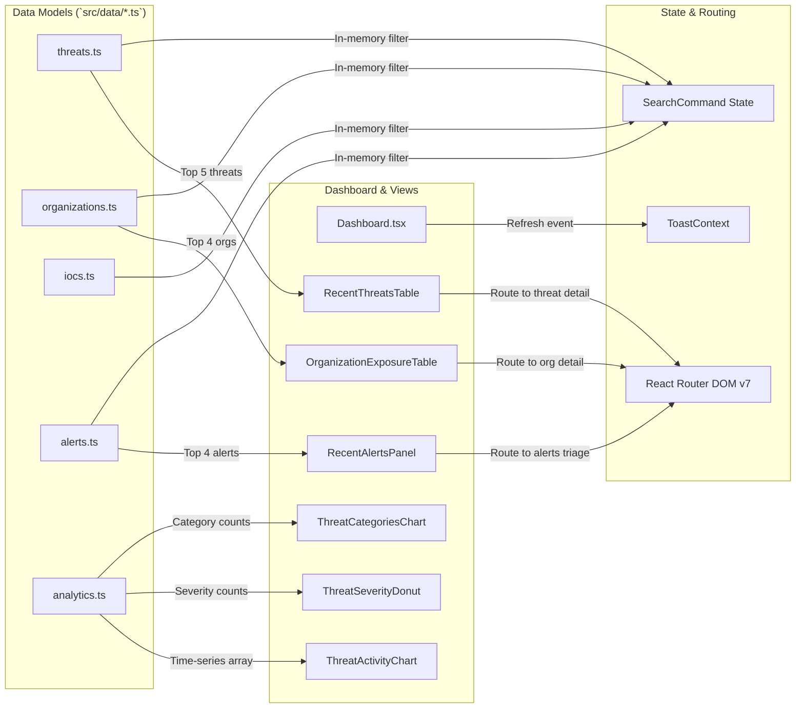
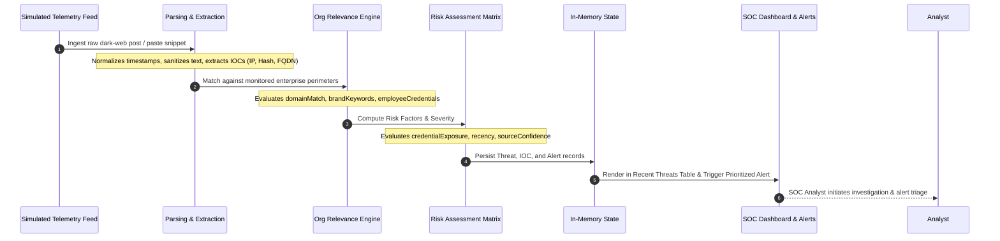

# System Architecture Specification
## DARKTRACE: Dark Web Threat Intelligence & Organization Exposure Monitoring Platform

---

## 1. Architectural Overview

DARKTRACE is architected as a modular, responsive **Client-Side Single Page Application (SPA)** built with React 19, TypeScript 6.0, and Vite 8.3. The architecture prioritizes separation of concerns, strict type enforcement, deterministic component rendering, and zero-latency in-memory data processing.

```
+-------------------------------------------------------------------------------+
|                             CLIENT APPLICATION (SPA)                          |
|                                                                               |
|  +-------------------------------------------------------------------------+  |
|  |                        PRESENTATION / UI LAYER                          |  |
|  |  - AppLayout (Global Grid & Shell)                                      |  |
|  |  - TopNavbar (Dynamic Breadcrumbs, Notifications, Search Invoker)       |  |
|  |  - Sidebar (Collapsible Navigation, Module Sections, Branding)         |  |
|  +-------------------------------------------------------------------------+  |
|                                     |                                         |
|                                     v                                         |
|  +-------------------------------------------------------------------------+  |
|  |                        DASHBOARD & ANALYTICS LAYER                      |  |
|  |  - StatCard (KPI Visualizers)                                           |  |
|  |  - ThreatActivityChart (Recharts AreaChart, Multi-Timeframe)            |  |
|  |  - ThreatSeverityDonut (Recharts PieChart, Percentage Legend)           |  |
|  |  - ThreatCategoriesChart (Recharts Horizontal BarChart)                 |  |
|  |  - OrganizationExposureTable (Perimeter Ranking & Trend Indicators)     |  |
|  |  - RecentThreatsTable (Telemetry Stream, Confidence Bars, Statuses)     |  |
|  |  - RecentAlertsPanel (Prioritized Alert Queue & Triage)                 |  |
|  |  - SearchCommand (Ctrl+K Keyboard-Driven Multi-Entity Palette)          |  |
|  +-------------------------------------------------------------------------+  |
|                                     |                                         |
|                                     v                                         |
|  +-------------------------------------------------------------------------+  |
|  |                   APPLICATION CONTEXT & ROUTING LAYER                   |  |
|  |  - React Router DOM v7 (Route Hierarchy, History, Dynamic Params)      |  |
|  |  - ToastContext (Event Messaging & Transient Notifications)             |  |
|  +-------------------------------------------------------------------------+  |
|                                     |                                         |
|                                     v                                         |
|  +-------------------------------------------------------------------------+  |
|  |                         IN-MEMORY DATA LAYER                            |  |
|  |  - threats.ts       (Synthetic Ingested Threat Incidents)               |  |
|  |  - organizations.ts (Monitored Corporate Entities & Exposure Scores)    |  |
|  |  - actors.ts        (Adversary Profiles & TTPs)                         |  |
|  |  - iocs.ts          (Extracted Indicators: IP, Hash, URL, Domain)       |  |
|  |  - alerts.ts        (Security Alert Queue Items)                        |  |
|  |  - analytics.ts     (Aggregated Metrics, Historical Time-Series)        |  |
|  |  - sources.ts       (Telemetry Feed Registry & Health)                  |  |
|  +-------------------------------------------------------------------------+  |
|                                     |                                         |
|                                     v                                         |
|  +-------------------------------------------------------------------------+  |
|  |                          TYPE DOMAIN MODEL                              |  |
|  |  - src/types/index.ts (Strict TypeScript Schemas & Unions)              |  |
|  +-------------------------------------------------------------------------+  |
+-------------------------------------------------------------------------------+
```

---

## 2. Layered Component Architecture

### 2.1 Shell & Layout Layer (`src/components/layout`)
- **`AppLayout.tsx`**: Top-level viewport manager that houses the sticky navigation header and the collapsible sidebar navigation. It ensures smooth layout responsiveness across desktop and mobile form factors.
- **`Sidebar.tsx`**: Stateful navigation container organized into three logical operational tiers:
  - *Core Intelligence*: Overview, Threat Intelligence, Organizations, Threat Actors, IOC Intelligence, Exploit Intelligence, Alerts, Threat Graph, Analytics, Reports.
  - *Telemetry*: Intelligence Sources, Live Monitoring.
  - *System*: Settings & Preferences, Documentation & Help.
- **`TopNavbar.tsx`**: Dynamic header featuring automated breadcrumb segment generation derived from `window.location.pathname`, unread alert notifications popover, and the primary search trigger button.

### 2.2 Reusable Atomic Components (`src/components/common`)
- **`SeverityBadge.tsx`**: Color-coded pill badge mapping standard security severities (`critical`, `high`, `medium`, `low`, `informational`) to specialized Lucide icons and background border tones.
- **`ConfidenceBar.tsx`**: Visual percentage bar rendering confidence levels (0–100%) with dynamic color shifts (green >=90, blue >=75, amber >=50, slate <50).
- **`StatusBadge.tsx`**: Threat lifecycle indicator mapping states (`New`, `Investigating`, `Resolved`, `False Positive`) with animated pulsing status dots.
- **`StatCard.tsx`**: Metric KPI widget featuring trend direction calculations (`ArrowUpRight`, `ArrowDownRight`, `Minus`) and cybersecurity-specific positive/negative color semantic mapping.
- **`SearchCommand.tsx`**: Modal command palette supporting real-time cross-dataset substring queries with keyboard navigation (`Ctrl+K` and `Escape`).

### 2.3 Visual Analytics Layer (`src/components/dashboard`)
- Encapsulates Recharts graphics wrapped in responsive containers.
- Decouples visual SVG rendering from data ingestion, allowing data feeds to be hot-swapped without modifying chart logic.

---

## 3. High-Level Data Flow Diagram



---

## 4. Threat Intelligence Processing Lifecycle



---

## 5. Architectural Verification & Integrity

- **Backend Reality:** There is no server-side Node.js or Python process running. The application operates in the user's browser.
- **Data Persistence:** Data is read-only and loaded synchronously from static ES modules.
- **Routing:** Handled entirely on the client side using HTML5 History API via React Router DOM.
